# The asynchronous state in a liquid state machine — technical report

Extension of Renart et al. (2010) to reservoir computing. Code: `src/lsm/` (entry point
`python -m lsm.run`), configuration: `config.yaml → lsm`, cluster scripts:
`slurm/lsm_*.slurm`. Every number below comes from runs of that code at the commits on `main`.

**Questions**

1. Does the paper's claim (dense, strongly coupled E/I networks are asynchronous because
   inhibition tracks and cancels shared excitation, so `r̄ ~ 1/N`) hold in a
   **reservoir-sized** spiking network (~500 neurons)?
2. What must be adjusted to make an LSM **faithful** to the paper's argument?
3. Is the faithful LSM a **better liquid** for event-camera classification (N-MNIST, DVS
   Gesture) than a classic Maass-style liquid?
4. Do the **published** liquids (Maass 2002, Kaiser 2017, Wijesinghe 2019, built as their
   authors specified) show the asynchronous state, and does their correlation structure
   (c_II, c_EI, …) predict their accuracy? (§7)

## 1. What the paper's argument requires

The SOM's theory (binary network, S§2.1–2.2) and the spiking network (S-p.20–21) rest on
four ingredients. An LSM is faithful to the argument only if it keeps all four.

| # | Ingredient | Where it enters the argument | Typical LSM (Maass et al. 2002) |
|---|---|---|---|
| 1 | **Dense** connectivity: `p` fixed (0.2) as N grows, so every pair shares a fraction p of its inputs | creates the shared-input correlation that must be cancelled | sparse, local (λ = 2 grid units), in-degree ~5–10 |
| 2 | **Strong** coupling: `J ~ 1/√K`, so mean E and I inputs are `O(√K)` and cancel to `O(1)` (balance) | balance is what lets I track E at a fast time scale | weights fixed, not scaled with K |
| 3 | **Dale's law with fast, strong inhibition** (`g_EI = g_II = 40 nS` against `g_EE = 2.4 nS`; I delays 0.1–0.9 ms against 0.5–1.5 ms for E) | the tracking condition: inhibition must follow excitation within a few ms | E/I mixed, inhibition not privileged |
| 4 | **Shared external drive X** with `p_X = p` | the correlated input whose fluctuations are tracked and cancelled | input to a random subset, usually 30 % of cells |

## 2. Size of the reservoir

The paper's spiking network has N = 5000 (4000 E + 1000 I); the binary network is swept over
N = 100 … 8192. **We use N = 500 (400 E + 100 I, the 4:1 ratio of both the paper and Maass
2002)**. That is the smallest size at which ingredient 2 still has a meaning:

- with `p = 0.2`, the E in-degree is `K_EE = 80`, and the balance parameter `√K ≈ 9 ≫ 1`.
  At N = 100 it would be `√16 = 4`, and the O(1) residual would be comparable to the O(√K)
  terms that are supposed to cancel;
- the theory predicts `r̄ ~ 1/N`, so N = 500 is 10× more correlated than the paper's
  network. That is a *testable* prediction, not a defect;
- N = 562 is a point on Fig. 2C's own grid, and LSMs for event data are typically 10²–10³
  neurons.

The asynchrony test spans **N = 250, 500, 1000, 2000, 5000**, so the reservoir size sits
inside a scaling law whose N = 5000 end **is the paper's network**.

## 3. Adjustments needed for a faithful LSM

### 3.1 Coupling must be rescaled — the network is silent otherwise

Shrinking block 3 to N = 500 with the paper's conductances (fixed nS values) gives **0 Hz**:
each neuron loses 90 % of its inputs, so the mean drive falls 10× and nothing reaches threshold.
The theory says how to shrink a balanced network: keep `J√K` fixed. For conductances, per
presynaptic population b:

```
g_ab(N) = g_ab^paper · √( N_b^paper / N_b )          (b ∈ {E, I, X})
```

This keeps `K_b · g_ab²` (the input variance) fixed while the mean E and I inputs scale as
`√K`. At N = 5000 it reduces exactly to the paper's values: a test pins this. Measured at
N = 500 with **no tuning**: **E 1.26 Hz, I 3.85 Hz** (paper at N = 5000: 1.0 / 3.6 Hz).

| N = 500 network | E rate | I rate |
|---|---|---|
| paper conductances, unchanged | 0.00 Hz | 0.00 Hz |
| √K-scaled (faithful) | 1.26 Hz | 3.85 Hz |

### 3.2 Everything else is kept

- Bernoulli(p = 0.2) wiring for all 6 population pairs, self-connections excluded.
- Dale's law, conductance-based synapses, `V_rev^I = −80 mV`, and the faster inhibitory
  delays.
- Per-synapse heterogeneity: g ~ truncated Gaussian(mean g, sd 0.5 g), with corrected
  moments.
- `dt = 0.05 ms`, rk2, and the same neuron (C_m = 0.25 nF, g_L = 16.7 nS, θ = −50 mV,
  reset −60 mV, refractory 2/1 ms).
- The 2.5 Hz Poisson background stays on every input channel, so the reservoir sits in its
  asynchronous operating point before, between and during stimuli.

### 3.3 Input encoding for event cameras (needed by any LSM, faithful or not)

- One X neuron per pooled pixel and polarity: N-MNIST 34×34 → 17×17×2 = **578** channels;
  DVS Gesture 128×128 → 16×16×2 = **512** channels. N_X therefore changes with the task, and
  the X conductances follow the same √ rule (`g_aX ∝ √(4000/N_X)`).
- Events are **thinned** with one dataset-wide keep-probability, which brings the mean
  stimulus rate per channel to 20 Hz (8× the background), inside the balanced network's
  linear-response range. q is estimated on 500 training samples only: **N-MNIST q = 0.740,
  DVS Gesture q = 0.164**. Measured input rates per chunk, including the 2.5 Hz background:
  N-MNIST 22 Hz, DVS Gesture 17–27 Hz.
- Samples are laid end to end with a 50 ms gap (~3 τ_m) so their states do not carry over.

### 3.4 Implementation: no second simulator

All variants are `block3.model.build_network` with different parameters. Two small,
test-pinned extensions made this possible:

- the per-neuron synaptic integration: exact, and ~140× faster;
- a `connect` hook for the Maass column topology.

The network an LSM result is reported on is therefore the same code that reproduces Fig. 3.

## 4. The variants compared

| variant | wiring | recurrent coupling | free parameter |
|---|---|---|---|
| **faithful** | Bernoulli p = 0.2 (dense) | √K-scaled (strong) | none |
| **dense_weak** (ablation) | Bernoulli p = 0.2 (dense) | paper nS values (weak at this K) | input gain |
| **maass** (classic LSM) | 3-D column, 5×5 cross-section, `P = C_ab·exp(−(D/λ)²)`, λ = 2, C = 0.3 / 0.2 / 0.4 / 0.1 for EE / E→I / I→E / II | paper nS values | input gain |

All three share the same input pathway (X → reservoir Bernoulli p = 0.2, √-scaled g). The one
free gain of each non-faithful variant is calibrated by bisection so that comparisons are at
**matched firing rate**:

- *asynchrony runs* match the background E rate (1.41 Hz at N = 500): gains dense_weak 0.952,
  maass 0.912;
- *classification runs* match the stimulus-driven rate (34.9 Hz on DVS Gesture training
  samples): gains dense_weak 0.559, maass 0.216.

Matching at background alone is not enough. The same stimuli then drive faithful at 36 Hz,
dense_weak at 61 Hz and maass at **206 Hz**. The unbalanced liquids have a much steeper gain,
and the Maass liquid needs 4.6× less input than faithful for the same driven rate. That is
itself a signature of the paper's mechanism: tracking makes the balanced network's response
linear and moderate.

## 5. Results — asynchrony (question 1)

Background-only runs (block 3's 2.5 Hz Poisson X, no task input), 100 s each, 3 network
realisations per point, measured with the paper's estimators. 21 runs, `artifacts/lsm/asynchrony.csv`.

### 5.1 The faithful LSM follows the paper's scaling law down to reservoir size

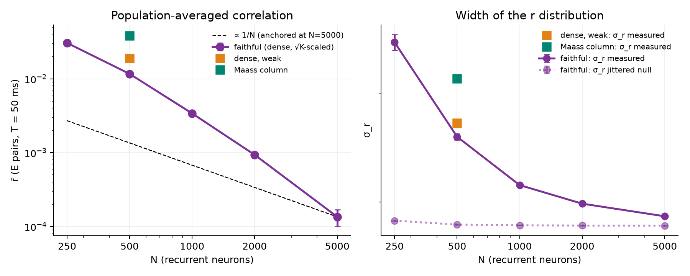

| faithful, N | 250 | **500** | 1000 | 2000 | 5000 (= block 3) |
|---|---|---|---|---|---|
| E / I rate (Hz) | 1.25 / 3.16 | **1.38 / 3.75** | 1.38 / 4.29 | 1.27 / 4.27 | 1.03 / 3.98 |
| r̄ (E pairs, T = 50 ms) | 0.031 | **0.0117** | 0.0034 | 0.00094 | 0.00014 |
| σ_r measured | 0.036 | **0.026** | 0.021 | 0.020 | 0.019 |
| σ_r of the jittered null | 0.019 | 0.018 | 0.018 | 0.018 | 0.018 |
| c_T, total current corr. | 0.067 | **0.051** | 0.035 | 0.019 | 0.0096 |
| E–I tracking (3 ms) | 0.56 | 0.60 | 0.61 | 0.60 | 0.62 |

- **r̄ falls as N^−1.82** (log-log fit over N = 250–5000), at least as fast as the theory's 1/N.
  The extra steepness at small N is plausibly the finite-K correction: at √K ≈ 6–9 the balance
  is imperfect, and the residual correlation that it leaves decays faster than the
  asymptotic 1/N.
- **c_T falls as N^−0.66**, against the theory's 1/√N (exponent −0.5).
- **σ_r ≫ r̄ at every N** (at N = 500, 0.026 against 0.012), and σ_r stays above its
  jittered null, so individual pairs keep real correlations of both signs.
- The N = 5000 point is the paper's own network: r̄ = 1.4 × 10⁻⁴, matching the block 3
  reproduction (1.6 × 10⁻⁴ over 10 networks × 200 s).

**Answer to question 1: yes.** The asynchronous state survives, through the same mechanism, in
a 500-neuron reservoir, provided the reservoir keeps the four ingredients and the √K
coupling. Its residual correlation is larger (r̄ ≈ 0.012), exactly as the 1/N law predicts.

### 5.2 The mechanism: cancellation of current correlations

The current correlations must be measured on currents averaged over the count window T
(the SOM's filtered currents, Fig. S6). On raw 1 ms currents, the total stays at ~0.15 for
every N, because Poisson shot noise is faster than inhibition can track (τ_d = 5 ms) and
spikes do not respond to it. See `figures/lsm_current_scaling_1ms.png`.

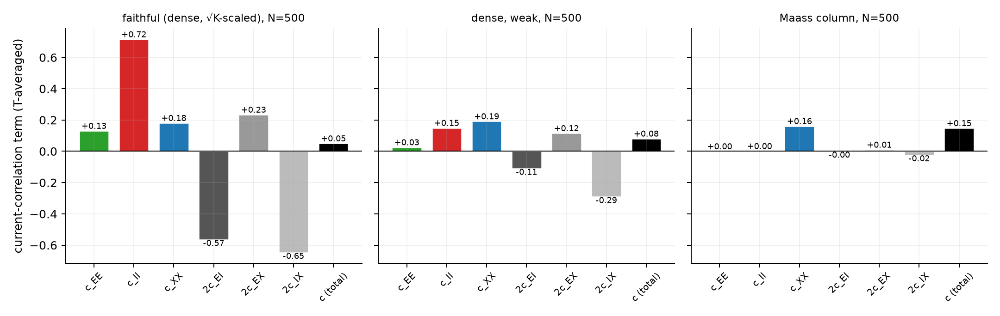

At N = 500 and **equal background rate**:

| variant | c_EE | c_II | c_XX | 2c_EI | 2c_EX | 2c_IX | **c (total)** | **r̄** | σ_r |
|---|---|---|---|---|---|---|---|---|---|
| faithful | +0.13 | +0.72 | +0.18 | **−0.57** | +0.23 | **−0.65** | **0.051** | **0.0117** | 0.026 |
| dense_weak | +0.03 | +0.15 | +0.19 | −0.11 | +0.12 | −0.29 | 0.082 | 0.0190 | 0.027 |
| maass | +0.00 | +0.00 | +0.16 | −0.00 | +0.01 | −0.02 | 0.148 | **0.0386** | 0.032 |

- **Faithful.** Large positive terms (sum ≈ +1.03) are cancelled by large negative E–I and
  I–X terms (≈ −1.22, offset by +0.23 from E–X) down to 0.05: the paper's mechanism.
- **Maass liquid.** The recurrent currents are tiny (in-degree ~6), so the cell's current
  is essentially its share of the external input. c ≈ c_XX ≈ 0.15, with nothing to cancel
  it, and r̄ is **3.3× higher than faithful at the same firing rate**.
- **dense_weak** sits in between: dense wiring alone is not enough; the strong coupling
  (ingredient 2) does the cancelling.

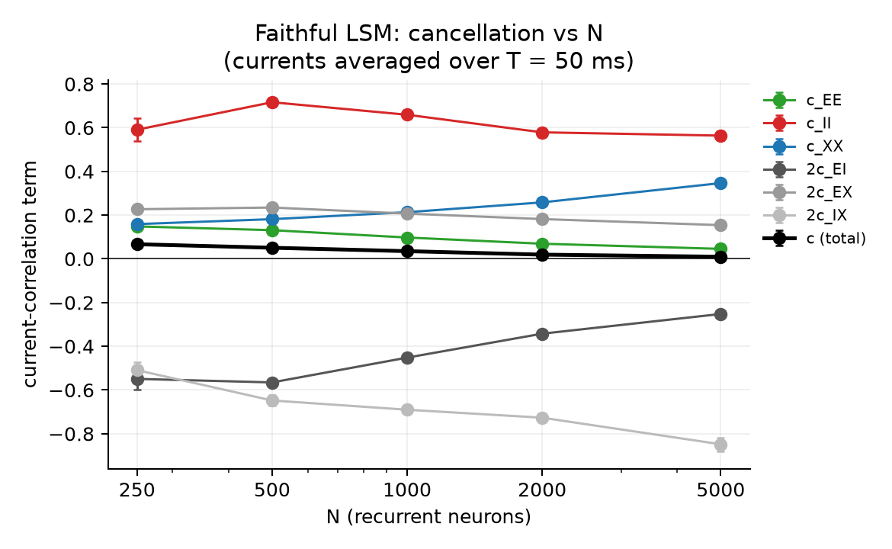

As N grows, the dominant negative term moves from 2c_EI to 2c_IX: inhibition increasingly
tracks the external input itself, while the total c falls monotonically. This is the
paper's tracking picture, with I following X as well as E.

## 6. Results — classification (question 3)

N = 500, all variants at **matched stimulus-driven rate**, the same input encoding, and the
same readout. The readout is multinomial logistic regression on standardised per-neuron spike
counts in time bins: 10 × 150 ms for Gesture, 6 × 50 ms for N-MNIST. Its L2 strength is
chosen per variant on a validation slice of the training split. Test sets are untouched until
the final score.

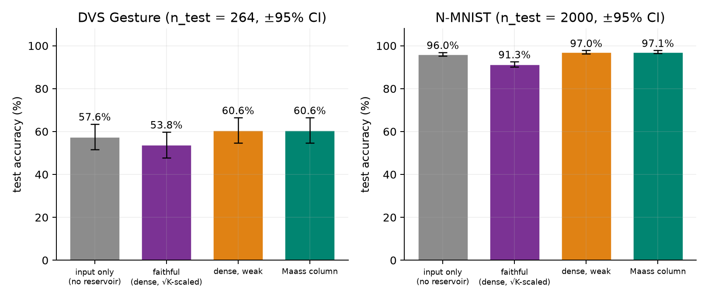

| | DVS Gesture (1077 train / 264 test) | N-MNIST (10 000 / 2000) |
|---|---|---|
| input only (no reservoir) | 57.6 % | 96.05 % |
| **faithful** | **53.8 %** | **91.3 %** |
| dense_weak | 60.6 % | 97.05 % |
| Maass column | 60.6 % | **97.1 %** |
| 95 % CI half-width | ± 6 points | ± 1.2 points |

**Answer to question 3: no, at N = 500 the faithful LSM is the *worst* liquid.**
- On N-MNIST, faithful is 5.8 points behind the Maass liquid, well outside the intervals.
- On DVS Gesture, all four lie within one interval of each other. A 264-sample test set cannot
  separate them, and all are near the input-only baseline.

### 6.1 Why: the asynchronous state is mostly self-generated variability

The same 100 test samples were run twice through the same reservoir with independent
encoding/background noise. The figure shows the fraction of feature variance shared between
the two repeats (`lsm.readout.reliability`, unbiased for the stimulus-locked share):

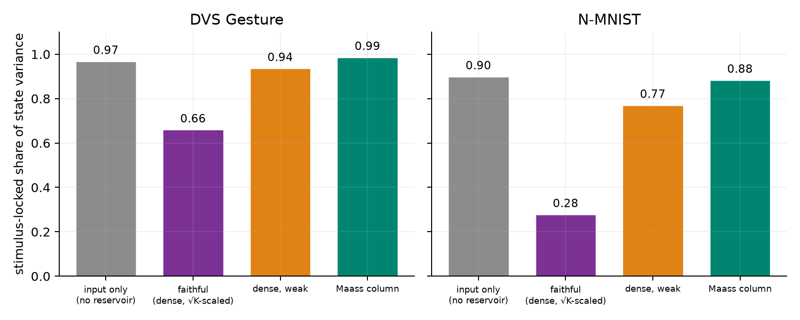

| stimulus-locked share | input | faithful | dense_weak | maass | participation ratio (faithful / maass) |
|---|---|---|---|---|---|
| DVS Gesture | 0.97 | **0.66** | 0.94 | 0.99 | 105 / 5 |
| N-MNIST | 0.90 | **0.28** | 0.77 | 0.88 | 179 / 10 |

- **The faithful liquid is high-dimensional, but mostly not about the input.** Its state
  spreads over 18–20× more dimensions than the Maass liquid's. On N-MNIST only 28 % of its
  variance repeats when the same digit is shown again; the other 72 % is generated by the
  network itself.
- **This is the other face of the paper's mechanism.** Strong coupling makes the balanced
  network amplify small fluctuations into irregular, chaotic activity (van Vreeswijk &
  Sompolinsky 1996). That activity is exactly what decorrelates neurons from *each other*.
  It also decorrelates the response from *trial to trial*: asynchrony and reliability come
  from the same source.
- **The Maass liquid is the opposite.** Its state is a few large shared modes
  (participation ratio 5–10, the input's own correlations, uncancelled) but almost
  deterministic given the input (0.88–0.99). For a linear readout with ~10³–10⁴ training
  samples, reliability wins.

### 6.2 Does a larger faithful reservoir recover? Partly

The asynchronous state's noise is independent across neurons (the paper's point), so a readout
over more neurons should average it away; the Maass liquid's shared modes cannot be averaged
the same way. Both variants were rerun at **N = 2000**, with the same encoding, gains and
readout:

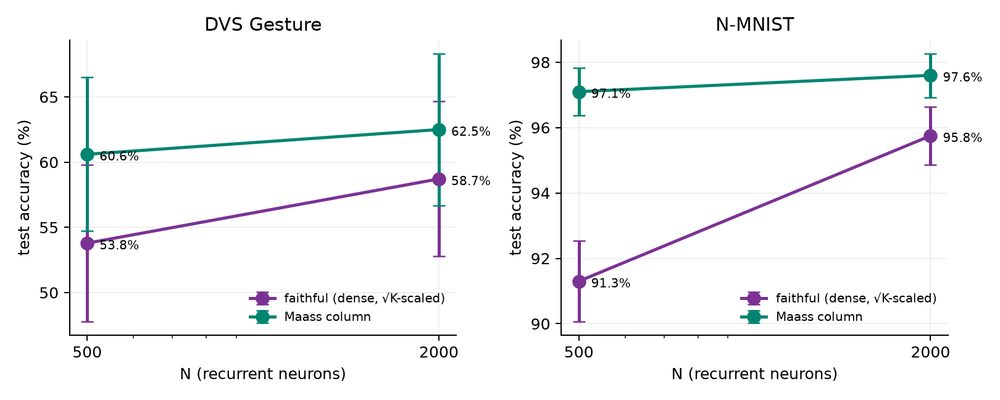

| test accuracy | N = 500 | N = 2000 | gain | participation ratio at 2000 |
|---|---|---|---|---|
| N-MNIST faithful | 91.3 % | **95.75 %** | **+4.45** | 866 |
| N-MNIST maass | 97.1 % | 97.6 % | +0.5 | 10.5 |
| Gesture faithful | 53.8 % | 58.7 % | +4.9 | 214 |
| Gesture maass | 60.6 % | 62.5 % | +1.9 | 5.5 |

- Quadrupling N buys the faithful liquid **~9× more accuracy than the Maass liquid on
  N-MNIST** (+4.45 against +0.5). The gap shrinks from 5.8 to 1.85 points, which is what
  averaging out neuron-independent noise predicts. Per-neuron reliability is unchanged
  (faithful 0.31 at N = 2000 against 0.28 at N = 500), so the gain comes from the population,
  not from quieter neurons.
- The faithful liquid **is still behind at N = 2000**, outside the N-MNIST interval
  (±0.9 points). On Gesture the intervals overlap at both sizes.
- Caveat: at N = 2000 the faithful reservoir fires at ~13 Hz under stimulus, against ~40 Hz at
  N = 500 (same input path, stronger balance at larger K). Its gain is therefore not from
  more spikes.

### 6.3 Conclusions

1. **The claim transfers.** A 500-neuron LSM built faithfully to the paper's argument is in
   the asynchronous state by the paper's mechanism. r̄ follows the N-scaling all the way to
   the paper's own network, and the cancellation is visible term by term in the currents.
2. **Faithfulness has a precise price.** The coupling must be rescaled as
   `g ∝ √(N_paper/N)`; a literal shrink of the paper's network is silent. Dense wiring alone
   (dense_weak) leaves the network only partially cancelled. Classic Maass liquids are not
   asynchronous by this mechanism: they inherit their input's correlations, about 3× higher.
3. **Faithful is not a better liquid, at least at N ≤ 2000 with a linear readout.** The same
   strong coupling that cancels correlations makes the network generate its own irregular
   activity. That decorrelates neurons, but also decorrelates the response across trials.
   The Maass liquid's low-dimensional, almost deterministic state classifies better.
4. **Where it could pay off.** The faithful liquid's deficit shrinks with N, as averaging
   predicts. It may close at larger N, with more training data, or with readouts designed to
   average population noise (e.g. pooling over neurons before the classifier). Testing
   N = 5000–10 000 and a less chaotic balanced regime (weaker J, slower inhibition) are the
   natural next experiments.

## 7. Published LSM designs: Maass 2002, Kaiser 2017, Wijesinghe 2019

The three variants above all use the paper's conductance-based neuron. This section asks the
same questions of three liquids **as their authors built them**: the trio compared by Woo et
al. 2024 (*Physica A* 633:129334, Table 1), all at N = 500 (400 E / 100 I). Code:
`src/lsm/designs.py`, parameters: `config.yaml → lsm.designs`, tests:
`tests/lsm/test_designs.py`.

### 7.1 What was built, and from which source

| | Maass 2002 | Kaiser 2017 | Wijesinghe 2019 |
|---|---|---|---|
| Source of every value | paper, Appendix B | released NEST code (IGITUGraz/LSM) | paper, Tables 1–2; Diehl & Cook 2015 |
| Neuron | current LIF, τ_m 30 ms, R 1 MΩ, I_back 13.5 nA | current LIF, τ_m 30 ms, R 1 GΩ, I_e 14.5 pA | conductance LIF, τ_m 100 / 10 ms (E/I) |
| Rest vs threshold | 13.5 vs 15 mV | 14.5 vs 15 mV | −65 vs −52 mV (E), no background |
| Synapse | exp. PSC 3/6 ms, Tsodyks–Markram STP, U/D/F ~ N(mean, 50 %) | exp. PSC 3/2 ms, STP fixed per pair | exp. conductance 1/2 ms, static |
| Weights | gamma, CV 1: 30, 60, −19, −19 nA | clipped normal, CV 0.7: 50, 250, −200, −200 pA | U(0, 1) nS |
| Wiring | 5×5×20 column, C·e^{−(D/λ)²}, λ = 2 | fixed in-degree 2 E + 1 I | Bernoulli 0.4 / 0.4 / 0.5, no I→I |
| Links | 3620 (review: 3630 ± 15) | 1500 (exact) | 99 840 expected (exact up to sampling) |
| Delays | 1.5 ms (E→E), 0.8 ms | clipped normal, mean 10, SD 20, [3, 200] ms | none |
| Input | each channel → 30 % of neurons, 18 / 9 nA | out-degree 100 → E only, U(125, 375) pA | 10 % → E only, U(0, 1) nS |
| Noise | none | independent 25 Hz Poisson per neuron, N(1, 0.7) pA | none |

The tests check, against independent sources:
- the review's link counts, including Kaiser's exact in-degrees;
- the STP jump sizes, against Markram's closed-form recursion;
- each neuron's rest point and its synaptic-current decay.

Choices and deviations to state:
- **The review's Maass link split is not Maass's.** Its 594 / 578 / 143 links (E→I, I→E,
  I→I) are what C = 0.3 for every pair gives. Maass's own C is 0.3 / 0.2 / 0.4 / 0.1, which
  gives 398 / 793 / 47. The primary source is followed; the total agrees either way.
- **Inferred values.** Maass's input synapses are static and undelayed, since he gives
  neither STP nor delay for them. Negative U/D/F draws are redrawn from U(0, 2·mean), his
  "appropriate uniform distribution".
- **Starting state.** Every STP synapse starts at rest (u = 0, x = 1). Kaiser's code starts
  at a 10 Hz steady state computed with mixed ms/s units; the difference lasts about
  τ_rec ≤ 0.8 s.
- **Reversal potentials.** Wijesinghe et al. state none; Diehl & Cook's are used (0 mV, and
  −100 / −85 mV for inhibition onto E / I cells).
- **Input gain.** Each design's input weights were set for its authors' input, so one gain
  on all X weights is calibrated, as for every other variant.
  - The task gains match faithful's driven rate of 34.8 Hz: Maass 2002 0.0127, Kaiser 2017
    0.00124, Wijesinghe 2019 5.36.
  - The background gains match faithful's E rate of about 1.4 Hz: Maass 2002 0.031,
    Wijesinghe 2019 3.87.
  - **Kaiser 2017 cannot be matched at background.** It fires at 4.9–5.4 Hz with zero input,
    because its cells rest 0.5 mV under threshold and a single E→E spike is worth several
    mV. It is reported at the bracket's floor (gain 10⁻⁴), so its background row is not at
    equal rate.

### 7.2 Asynchrony at background (question 1, for the published designs)

Background X only (2.5 Hz Poisson), 3 networks × 100 s, N = 500, T = 50 ms:

| liquid | E / I rate (Hz) | r̄ | σ_r (null) | c_EE | c_II | c_EI | c (total) | E–I tracking |
|---|---|---|---|---|---|---|---|---|
| faithful (√K-scaled) | 1.38 / 3.77 | **0.012** | 0.026 (0.018) | 0.13 | 0.72 | −0.28 | **0.05** | 0.60 |
| dense_weak | 1.42 / 2.18 | 0.019 | 0.027 (0.019) | 0.03 | 0.15 | −0.06 | 0.08 | 0.59 |
| Maass column (Renart neuron) | 1.50 / 1.53 | 0.039 | 0.032 (0.019) | 0.00 | 0.00 | 0.00 | 0.15 | 0.64 |
| **Maass 2002** | 1.41 / 1.44 | **0.68** | 0.20 (0.03) | 1.03 | 0.19 | −0.42 | **0.40** | 0.92 |
| **Kaiser 2017** (not rate-matched) | 4.48 / 16.0 | 0.044 | 0.063 (0.018) | 0.02 | 0.04 | −0.02 | 0.02 | 0.43 |
| **Wijesinghe 2019** | 1.35 / 6.36 | 0.022 | 0.029 (0.018) | 0.15 | 1.07 | −0.29 | **0.59** | 0.67 |

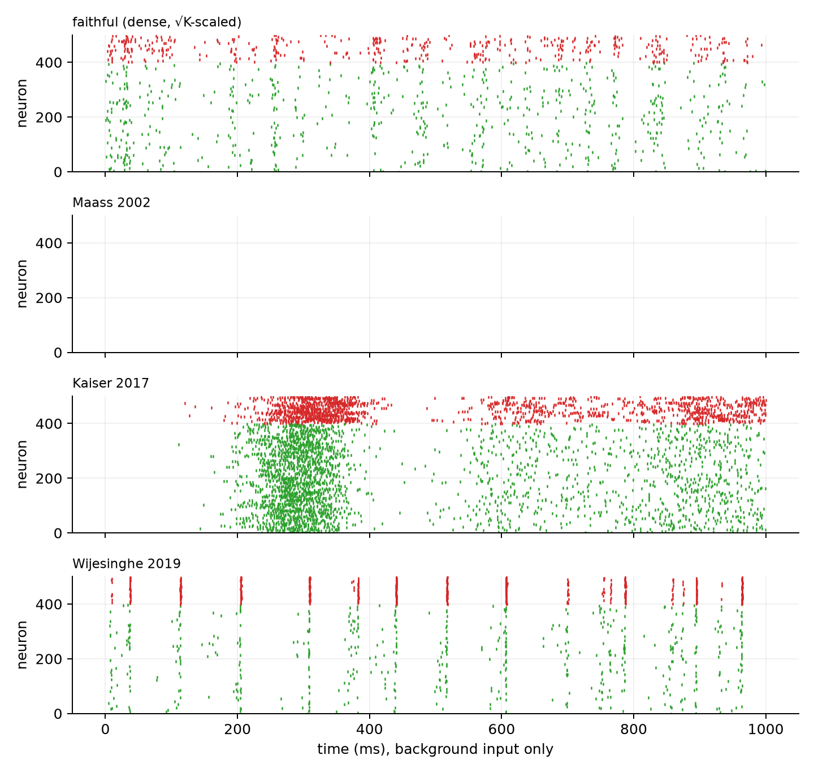
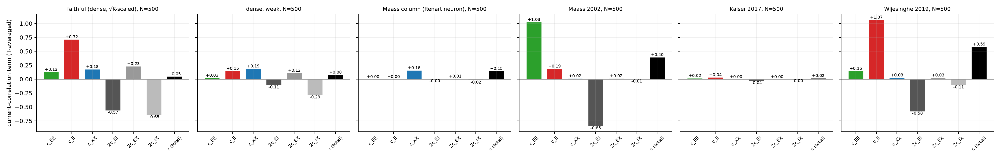

**None of the published liquids is asynchronous by the paper's mechanism.**

- **Maass 2002 is in an avalanche regime.**
  - Over 20 s it is silent 96 % of the time. About every 3 s it fires a 60–80 ms population
    burst that recruits 84–96 % of all E cells.
  - That is why r̄ = 0.68, and why c_EE = 1.03 is only partly cancelled by c_EI = −0.42.
  - The same column with the Renart neuron (the "maass" variant) sits at r̄ = 0.039. The
    neuron and synapse model, not the wiring, creates the bursts: cells rest 1.5 mV below
    threshold, the weights are heavy-tailed (gamma, CV 1), and depression ends each burst.
- **Wijesinghe 2019 oscillates.**
  - It fires inhibitory population volleys at roughly 10 Hz (raster). With no I→I synapses,
    nothing desynchronises the I population.
  - So c_II = 1.07 stands nearly uncancelled, and c reaches 0.59, the highest of all.
  - Spike-count r̄ stays low (0.022) because each E cell joins only a few volleys: 1.35 Hz
    against a ~10 Hz rhythm.
- **Kaiser 2017 is decorrelated by sparseness, not by balance.**
  - With 2 E + 1 I inputs per cell, two cells almost never share an input, so every
    component is small (c = 0.02). There is nothing to cancel.
  - Its spiking is not asynchronous all the same: σ_r is 3.5× its null. This is the
    sparse-network route of van Vreeswijk & Sompolinsky, not the dense route this paper is
    about.
- **Only the faithful liquid** has large components (c_II = 0.72, c_EE = 0.13) cancelled by
  a large negative c_EI (−0.28) down to c = 0.05. That is the paper's signature.

### 7.3 Asynchrony while driven: signal and noise correlations

Background asynchrony is the paper's definition. A liquid, however, computes while driven. So
the 100 reliability test samples were run twice through each reservoir, with independent
input noise (`src/lsm/driven.py`). With x_k = s + n_k for repeats k = 1, 2:
- the cross-repeat covariance gives the stimulus-locked (signal) part;
- the repeat difference gives the trial-to-trial (noise) part, which is what the asynchrony
  claim is about;
- the same difference applied to the T-averaged currents gives a noise c-decomposition.

Spike-count correlations of E cells (T = 50 ms) and the total noise current correlation:

| liquid | N-MNIST: r_total / r_signal / r_noise / c_noise | DVS Gesture: r_total / r_signal / r_noise / c_noise |
|---|---|---|
| faithful | 0.038 / 0.155 / **0.004** / **0.013** | 0.032 / 0.065 / **0.004** / **0.009** |
| dense_weak | 0.089 / 0.118 / 0.002 / 0.014 | 0.078 / 0.092 / 0.004 / 0.013 |
| Maass column | 0.355 / 0.384 / 0.020 / 0.073 | 0.375 / 0.392 / 0.036 / 0.076 |
| Maass 2002 | 0.675 / 0.757 / **0.024** / **0.121** | 0.701 / 0.767 / **0.048** / **0.128** |
| Kaiser 2017 | 0.547 / 0.661 / 0.007 / 0.013 | 0.374 / 0.473 / 0.012 / 0.016 |
| Wijesinghe 2019 | 0.035 / 0.055 / 0.000 / 0.094 | 0.053 / 0.065 / 0.002 / 0.053 |

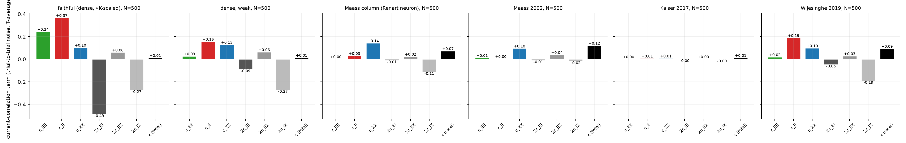

- **The paper's mechanism survives drive, and only in the faithful liquid.** Its noise
  currents still cancel: c_EE 0.24 + c_II 0.37 + 2c_EI −0.49 + … = 0.013. The other liquids
  have small components and nothing to cancel, apart from Wijesinghe's uncancelled c_II.
- **Most of a liquid's correlation under drive is stimulus-locked.** Kaiser's r_total of
  0.55 is almost all signal: its r_noise is 0.007. Correlated firing that repeats on every
  presentation carries the stimulus; it is not noise.

### 7.4 Classification

| test accuracy (%) | input | faithful | dense_weak | Maass column | **Maass 2002** | **Kaiser 2017** | **Wijesinghe 2019** |
|---|---|---|---|---|---|---|---|
| N-MNIST (n = 2000, ±~0.9) | 96.0 | 91.3 | 97.0 | 97.1 | 96.4 | 95.3 | 96.4 |
| DVS Gesture (n = 264, ±~5.8) | 57.6 | 53.8 | 60.6 | 60.6 | **65.9** | **66.3** | 58.3 |
| stimulus-locked share, N-MNIST | 0.90 | 0.28 | 0.77 | 0.88 | 0.74 | 0.51 | 0.69 |
| stimulus-locked share, Gesture | 0.97 | 0.66 | 0.94 | 0.99 | 0.98 | 0.90 | 0.97 |
| participation ratio, Gesture / N-MNIST | 114 / 229 | 105 / 179 | 47 / 94 | 5 / 10 | 2.5 / 7.8 | 7.5 / 22 | 24 / 56 |

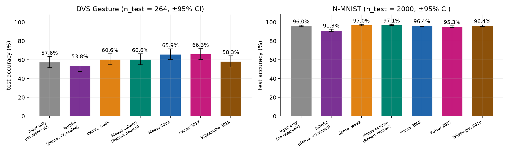

- **N-MNIST:** the published designs land between faithful and the best liquids. None beats
  the input-only baseline by more than its CI.
- **DVS Gesture:** Maass 2002 and Kaiser 2017 are the best liquids measured (≈ 66 %). They
  are clearly above faithful (53.8 %, non-overlapping 95 % intervals), but not separable
  from the Maass column or dense_weak (60.6 %) on 264 test samples.

### 7.5 Do correlations predict performance?

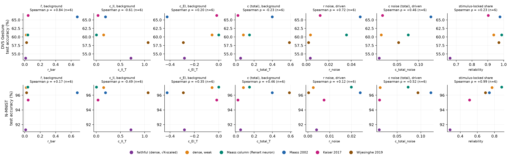

Six liquids per dataset, so the Spearman ρ values are a trend, not a test:

| Spearman ρ with accuracy | r̄ | c_II | c_EI | c (total) | r_noise (driven) | c_noise (driven) | stimulus-locked share |
|---|---|---|---|---|---|---|---|
| N-MNIST | +0.17 | −0.49 | +0.35 | +0.46 | +0.12 | +0.52 | **+0.99** |
| DVS Gesture | **+0.84** | −0.61 | +0.20 | −0.23 | +0.72 | +0.46 | +0.23 |

1. **No asynchrony measure predicts accuracy in the paper's direction.** Lower r̄, lower c or
   a more negative c_EI never goes with higher accuracy. On Gesture the trend runs the other
   way: the two most correlated liquids (Maass 2002 and Kaiser) are the best.
2. **c_II has a negative trend on both datasets** (ρ = −0.49 and −0.61). Large shared
   inhibition goes with lower accuracy. It belongs to faithful (balanced) and Wijesinghe
   (oscillating), whose shared inhibition is strong for opposite reasons.
3. **Reliability is the best single predictor on N-MNIST** (ρ = +0.99): the share of the
   liquid's state that repeats across presentations. On Gesture every liquid but faithful is
   above 0.9, so it saturates there, and the ordering among the rest is not resolved.

### 7.6 Conclusions for the published designs

- **Does the asynchronous state appear in the published LSMs? No.** At equal rate their
  background r̄ spans 0.02 to 0.68. Maass 2002 bursts, Wijesinghe 2019 oscillates, and
  Kaiser 2017 is decorrelated only by being sparse. Cancellation by tracking inhibition
  appears only in the liquid built for it (faithful), at background and under drive.
- **Does performance change? Yes, by up to 12.5 points on DVS Gesture**, but not in the
  direction the asynchrony claim would suggest. The best gesture liquids are the most
  correlated ones, and the most asynchronous liquid is the worst on both datasets.
- **What predicts a good liquid here is reliability, not asynchrony.** A liquid helps when
  its state is stimulus-locked, and correlated, even bursty, activity is fine if it repeats.
  Asynchrony earned through chaotic balance trades reliability away (§6.1). That is the
  computational cost of the paper's mechanism at reservoir size.

## 8. Reproduce

```bash
PYTHONPATH=src python -m lsm.run calibrate                 # background gains (5 min)
PYTHONPATH=src python -m lsm.run calibrate_task dvs_gesture
sbatch slurm/lsm_asynchrony.slurm                          # 21 tasks
python src/lsm/prepare_nmnist.py <tonic dir> <out dir>      # once, needs tonic
for v in input faithful dense_weak maass; do
  sbatch --array=0-13 slurm/lsm_features.slurm dvs_gesture $v
  sbatch --array=0-23 slurm/lsm_features.slurm nmnist $v
  for d in dvs_gesture nmnist; do sbatch slurm/lsm_reliability.slurm $d $v; done
done
for v in faithful maass; do                                 # the N = 2000 runs
  sbatch --array=0-13 slurm/lsm_features.slurm dvs_gesture $v 2000
  sbatch --array=0-23 slurm/lsm_features.slurm nmnist $v 2000
done
PYTHONPATH=src python -m lsm.run aggregate
PYTHONPATH=src python -m lsm.run readout dvs_gesture && PYTHONPATH=src python -m lsm.run readout nmnist
PYTHONPATH=src python -m lsm.run plot
# §7, the published designs (after the above):
for d in maass2002 kaiser2017 wijesinghe2019; do
  sbatch slurm/lsm_calibrate.slurm calibrate $d                     # then copy gains into
  sbatch slurm/lsm_calibrate.slurm calibrate_task dvs_gesture $d    # config.yaml lsm.*gain
done
sbatch --array=21-29 slurm/lsm_asynchrony.slurm
for d in maass2002 kaiser2017 wijesinghe2019; do
  sbatch --array=0-23 slurm/lsm_features.slurm nmnist $d
  sbatch --array=0-13 slurm/lsm_features.slurm dvs_gesture $d
  for s in nmnist dvs_gesture; do sbatch slurm/lsm_reliability.slurm $s $d; done
done
for v in faithful dense_weak maass maass2002 kaiser2017 wijesinghe2019; do
  for s in nmnist dvs_gesture; do sbatch slurm/lsm_driven.slurm $s $v; done
done
PYTHONPATH=src python -m lsm.run aggregate && PYTHONPATH=src python -m lsm.run readout nmnist
PYTHONPATH=src python -m lsm.run readout dvs_gesture && PYTHONPATH=src python -m lsm.plot_designs
```
