# The Asynchronous State in Cortical Circuits — reproduction report

Renart, de la Rocha, Bartho, Hollender, Parga, Reyes & Harris, *Science* **327**, 587 (2010),
and its Supporting Online Material (SOM). Results produced 2026-10-26/27 from this repository
(commit history on `main`); compute on the lab's DGX Spark cluster (Slurm, 3 × 20 ARM cores).

## 1. The claim in one slide

Cortical neurons in a densely connected network share a fraction `p ≈ 0.1–0.3` of their inputs.
The textbook expectation is that shared input forces positive spike correlations of order `p`.
The paper shows that a **densely and strongly coupled E/I network** escapes this: inhibition
**tracks** excitation so fast and so precisely that the positive current correlations (`c_EE`,
`c_II`, shared external input) are cancelled by a large **negative** `c_EI`:

```
c = c_EE + c_II + 2·c_EI  ~  1/√N         (M-Eq 3)
r̄  ~  1/N ,    σ_r  ~  1/√N  ≫  r̄
```

Mean pairwise correlation vanishes while individual pairs stay strongly correlated in both
signs: an **asynchronous state** that is produced dynamically, without fine-tuning.

The paper argues it in three steps, one figure each, and this repository reproduces all three.

| Block | Figure | Model | What it shows |
|---|---|---|---|
| 1 | Fig. 1 | feedforward pair of current-based LIF cells | correlated E *and* I input decorrelates the output |
| 2 | Fig. 2 | recurrent **binary** network (Glauber dynamics) | the theory: `r̄ ~ 1/N`, cancellation, tracking |
| 3 | Fig. 3 | recurrent **conductance-based spiking** network, N_E=4000, N_I=1000, N_X=4000 | the realistic network, and an intracellular prediction |

## 2. Results

### Fig. 1 — a postsynaptic pair (10 000 s per point, the paper's length)

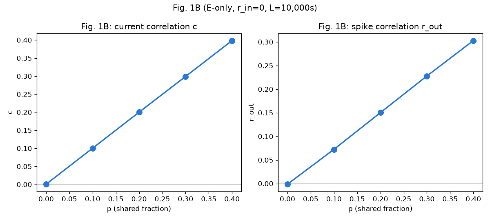

**1B. Shared input alone sets the correlation.** Input current correlation `c` equals the
shared fraction `p` to three decimals (0.000, 0.100, 0.199, 0.299, 0.401), and the output
spike correlation follows it (0.00 → 0.30). This is the "dense connectivity ⇒ correlation"
intuition the paper sets out to break.

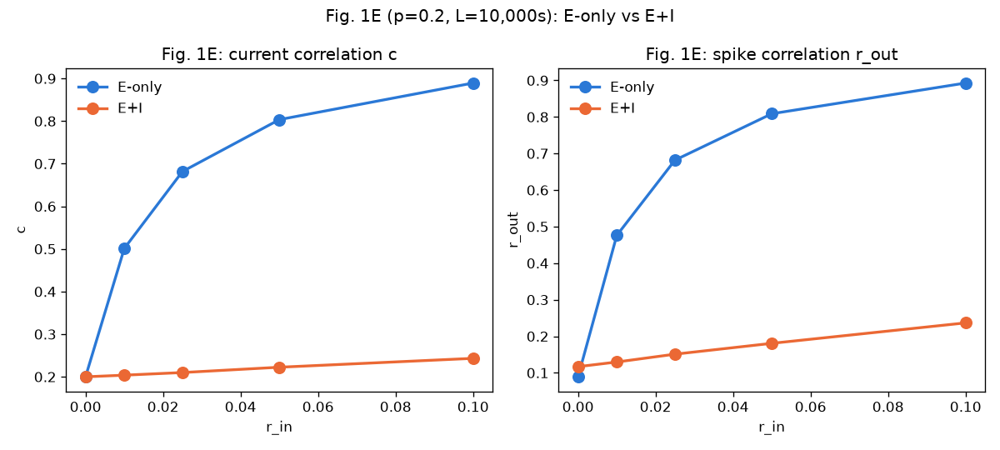

**1E. Adding correlated inhibition removes the correlation.** At `p = 0.2`, raising the input
correlation `r_in` from 0 to 0.1 drives an E-only cell pair to `c = 0.93`, `r_out = 0.93`. With
E **and** I inputs at the same `r_in`, `c` only climbs from 0.20 to 0.26 and `r_out` from 0.08
to 0.27. The E–I cross-correlation is negative and cancels the positive E–E and I–I terms.

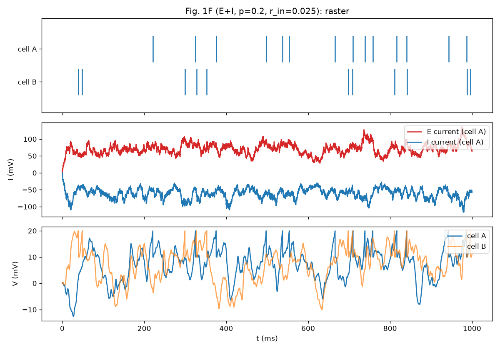

**1F.** The mechanism in one trace: the E and I currents into a cell co-fluctuate (mirror
images), so the net input and the voltage barely feel the shared fluctuations.

### Fig. 2 — the recurrent binary network (the theory)

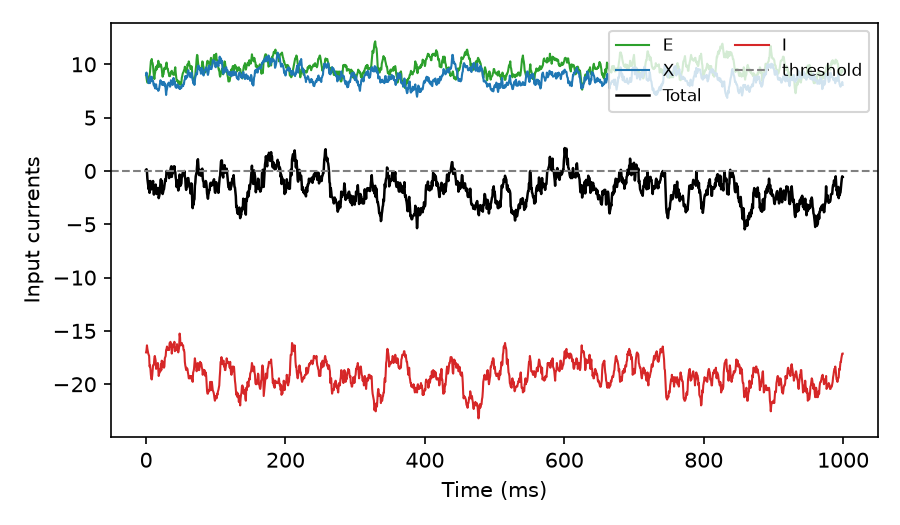

**2B. Balance.** E and X inputs (≈ +10) and the I input (≈ −19) are each far from threshold;
their sum hovers just below it. Spiking is driven by fluctuations around a balanced mean.

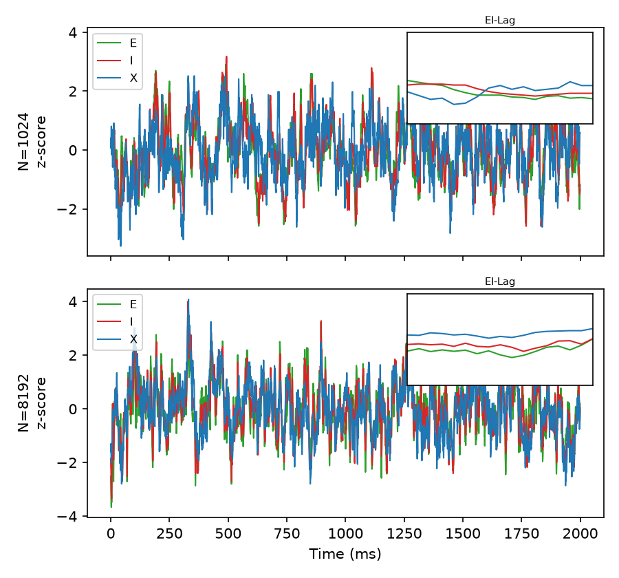

**2D. Tracking.** z-scored E, I and X population activity at N = 1024 and 8192: inhibition
follows excitation, which follows the external input, and the tracking tightens with N.

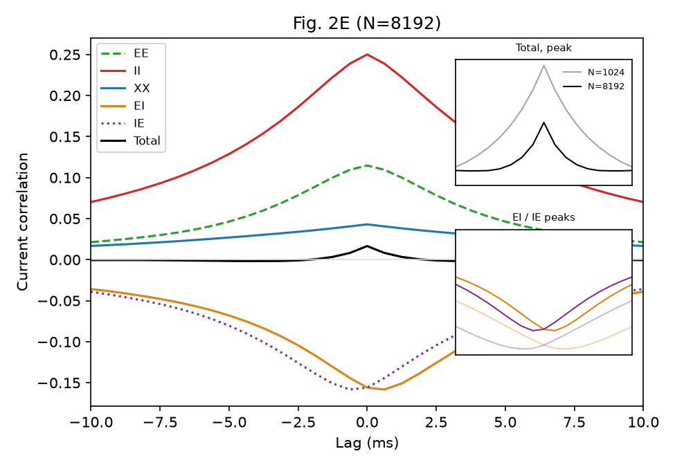

**2E. The cancellation, measured.** At N = 8192 the current-component cross-correlograms are
large: II +0.25, EE +0.11, XX +0.04. The E–I terms are large and **negative** (EI, IE ≈ −0.16).
The total is only **+0.017**, and its peak shrinks from N = 1024 to 8192 (inset).

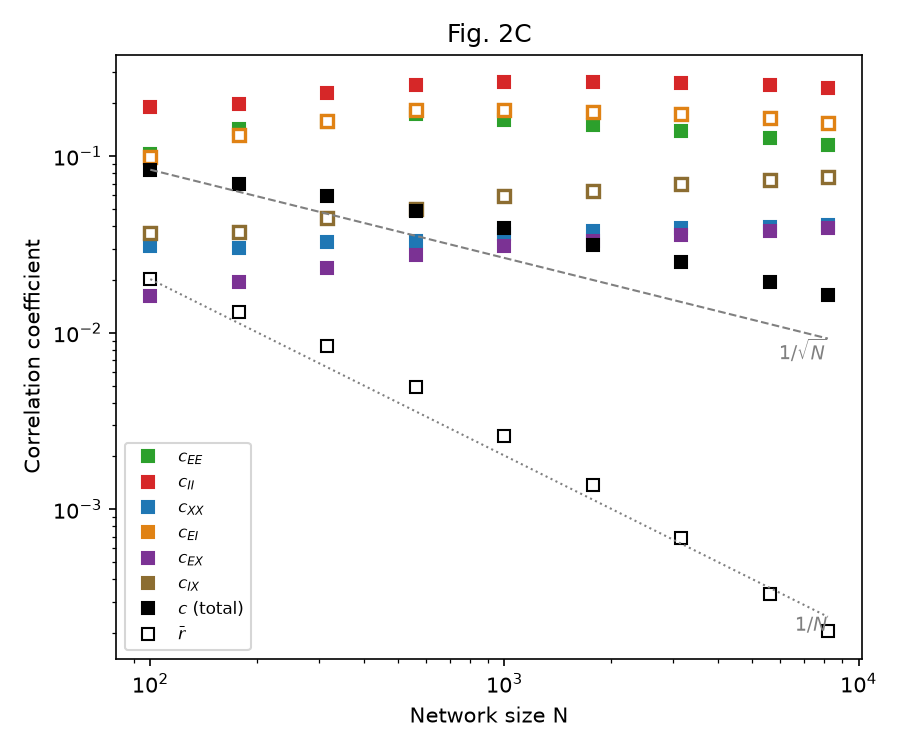

**2C. The scaling law, the block's central result** *(reduced sweep, see §4)*. Hollow markers
are negative values, plotted by magnitude.

| N | 100 | 178 | 316 | 562 | 1000 | 1780 | 3160 | 5620 | 8192 |
|---|---|---|---|---|---|---|---|---|---|
| r̄ (EE) | 2.0e-2 | 1.3e-2 | 8.5e-3 | 4.9e-3 | 2.6e-3 | 1.4e-3 | 6.9e-4 | 3.3e-4 | 2.0e-4 |
| c (total) | 0.084 | 0.069 | 0.059 | 0.049 | 0.039 | 0.031 | 0.025 | 0.019 | 0.016 |
| c_EI | −0.10 | −0.13 | −0.16 | −0.18 | −0.18 | −0.18 | −0.17 | −0.16 | −0.16 |
| c_II | 0.19 | 0.20 | 0.23 | 0.25 | 0.26 | 0.26 | 0.26 | 0.25 | 0.24 |

**r̄ falls along 1/N**: 98× over an 82× range of N (fitted slope −1.06; realisation SEM
under 1 % of the mean at N = 8192). **The total current correlation falls towards 1/√N**:
the fitted slope over the whole range is −0.37, but it steepens with N, to −0.47 between
N = 3160 and 8192. The components stay O(0.1–0.25) at every N. c_EI becomes more negative
up to N ≈ 600 and then holds at about −0.16, while c_EE and c_II shrink slightly with it.
That is the cancellation: each term stays large, while their sum vanishes.

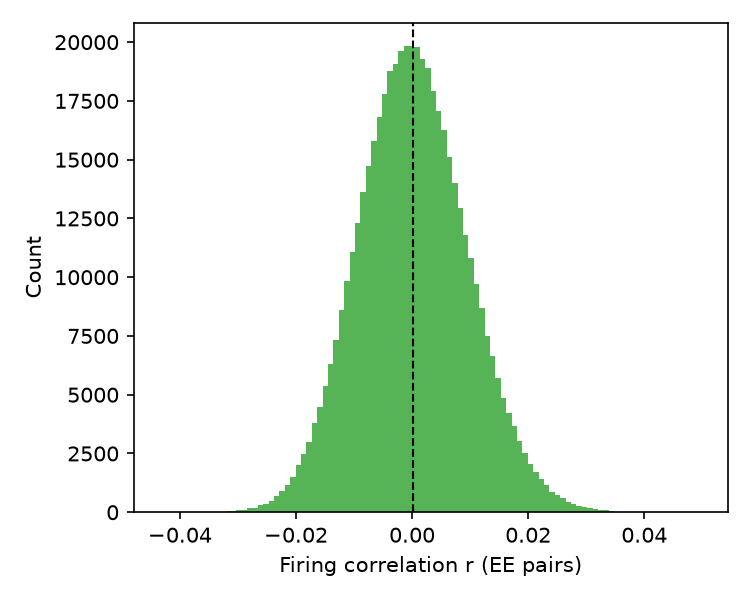

**2G.** ~500 000 E pairs at N = 8192: the r distribution is wide (σ_r ≈ 0.01) and centred on
zero (`r̄ ≈ 0`). Individual pairs are correlated in both signs while the mean vanishes.

### Fig. 3 — the conductance-based spiking network (the main target)

**3A–B statistics: 10 independent networks × 200 s** (the paper's protocol, all parameters
from SOM S-p.20–21):

| | this reproduction (mean, range over 10 networks) | paper |
|---|---|---|
| E rate | **1.04 Hz** (1.01 – 1.06) | 1.0 Hz |
| I rate | **3.98 Hz** (3.96 – 4.00) | 3.6 Hz |
| r̄ (E pairs, T = 50 ms) | **1.6 × 10⁻⁴** (1.3 – 2.0 × 10⁻⁴) | < 10⁻³ |

All ten networks are NaN-free; r̄ is positive but ~6× under the paper's bound.

**3A / 3B panels** come from a single network simulated for **5000 s, the SOM's length**
(4 h 41 min wall on an efficiency core, 82 GB peak):

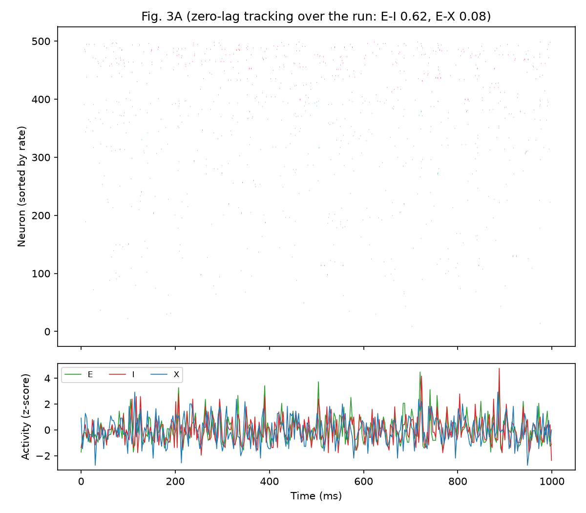

**3A.** The first second of 500 rate-sorted cells (400 E green, 100 I red): sparse,
irregular firing with no population events. Below, the z-scored E, I and X population
activities (3 ms bins). Over the whole run **I tracks E with a zero-lag correlation of 0.62**.
The E–X correlation is only 0.08 here, because X is a set of independent Poisson trains whose
pooled activity is white noise, with no slow fluctuation to track at 3 ms resolution.

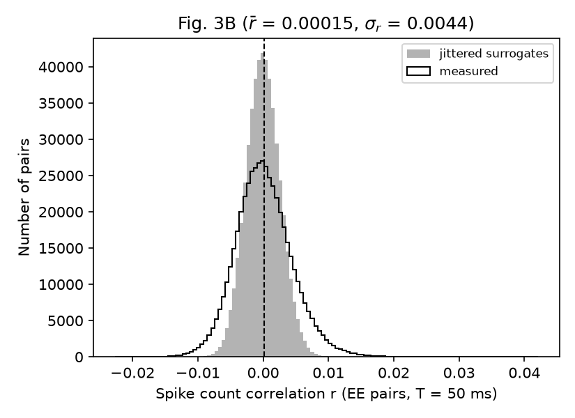

**3B.** All 499 500 E–E pairs of a 1000-cell sample, T = 50 ms. Measured: **r̄ = 1.5 × 10⁻⁴,
σ_r = 0.0044**. Jittered surrogate (±500 ms): r̄ = −2 × 10⁻⁶, σ_r = 0.0026. The distribution
is centred on zero and **wider than its null**: pairs carry real correlations of both signs
while the population average vanishes. That is the asynchronous state, and the paper's panel.

Recording length is a convergence check. From 2000 s to 5000 s the null narrows as 1/√T
(0.0041 → 0.0026, ratio 1.58 against √2.5 = 1.58), while the measured width settles at
0.0044. The excess, √(0.0044² − 0.0026²) ≈ 0.0035, is real pair-to-pair structure, not
finite-sample noise. r̄ is the same at both lengths (1.4 and 1.5 × 10⁻⁴).

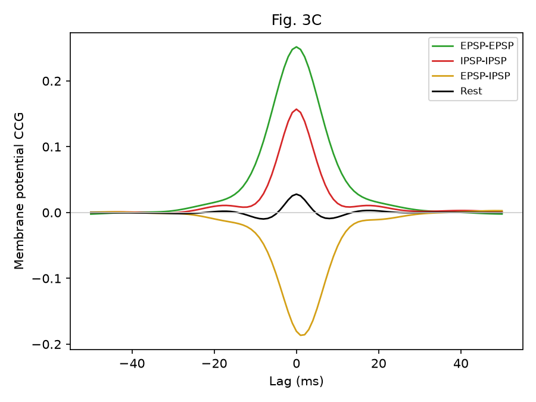

**3C. The experimentally testable prediction.** Spiking is disabled in recorded cells and a
constant current holds them near one reversal potential, isolating EPSPs or IPSPs.
Membrane-potential cross-correlograms, averaged over 10 networks × 50 s:

| pair condition | holding V | peak CCG | pairs |
|---|---|---|---|
| EPSP–EPSP (I_app = −1.3 nA) | −82 mV | **+0.25** | 450 |
| IPSP–IPSP (I_app = +3.7 nA) | +2 mV | **+0.16** | 450 |
| EPSP–IPSP | — | **−0.19** | 1000 |
| at rest (I_app = 0) | −60 mV | **+0.03** | 450 |

Isolated excitation is strongly shared and so is isolated inhibition. Excitation in one cell is
**anti**-correlated with inhibition in another. At rest, where a cell feels both, the two cancel
and almost nothing is left. In vitro this needs only paired whole-cell recordings.

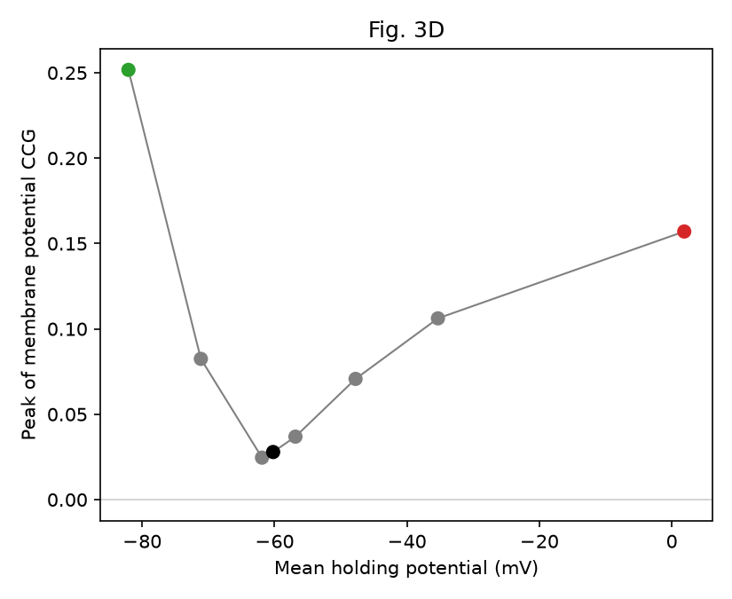

**3D. The V-shape.** Peak CCG against holding potential: high at both reversal potentials
(0.25 at −82 mV, 0.16 at +2 mV), minimal around rest (0.025 at −62 mV).

## 3. What was refined in this pass

1. **Block 3 is now ~140× faster, exactly.** The SOM's synapse (difference of exponentials,
   `τ_r = 1 ms`, `τ_d = 5 ms`) is linear, and its time constants and reversal potential depend
   only on the presynaptic type. So the summed conductance `S_c = Σ_j g_ij s_ij` of each neuron
   obeys the same two ODEs, driven by `τ̃ Σ_j g_ij δ(t − t_j − d_ij)`. Integrating 5000 neurons
   instead of ~9 M synapses per step changes nothing mathematically: a test pins the
   conductance against the closed-form kernel to 1 % of peak. Per-synapse `g_ij` and delays
   are kept. Measured on the cluster: **200 s in 11 min 44 s (3.8 GB)**, against **27 h 07 min**
   before. Rates are unchanged (E 1.03 vs 1.05 Hz on the same 5 s check). As a bonus, the
   conductance term now sits inside the `rk2` step with V, which removes a former Euler caveat.
2. Because of (1), **every Fig. 3 protocol ran at the paper's own length**: 10 × 200 s networks
   and the full 90-task Fig. 3C–D (10 networks × 9 conditions × 50 s). Fig. 3B grew from
   1000 s to the SOM's 5000 s.

## 4. Deviations to state on the slides

- **Fig. 2C is a reduced sweep**: 40 000 τ per realisation, and 5–20 realisations per N for r̄
  (2–3 for the current decomposition), against
  the paper's 200 000 τ and 50. Every N up to 8192 is kept, and each point's noise is ~√5
  wider. The paper's protocol costs ~16–24 h per N = 8192 realisation here.
- **I rate 3.98 Hz vs 3.6 Hz** (+10 %), consistent over all 10 networks. E rate and r̄ are on
  target.
- **Inferred, not stated, in the SOM** (all labelled in `config.yaml`):
  - only the 8 *printed* I_app levels are used, because the SOM elides the rest with "…";
  - 10 recorded cells per level per network, the only scheme that reproduces both stated
    pair counts (450 and 1000);
  - −1.3 nA is read as the EPSP condition and +3.7 nA as the IPSP condition;
  - the voltage CCG is a Pearson coefficient at 1 ms;
  - 100 ms burn-in;
  - X uses the excitatory delay range.

## 5. Talking points

- The paper's insight is **dynamical**: no parameter is tuned to make correlations vanish.
  Dense, strong coupling makes the network self-consistently track its input, and the tracking
  cancels shared fluctuations.
- **Three levels of evidence.** A two-cell model shows the arithmetic (1E). A solvable network
  shows it emerges, with the 1/N law (2C/2E). A realistic conductance-based network makes a
  wet-lab prediction (3C/3D).
- **What would falsify it.** If paired recordings at the two reversal potentials showed no
  negative EPSP–IPSP correlation, the cancellation account would fail.
- The extension (see `lsm_technical.md`): does the same mechanism exist in a reservoir-sized
  liquid state machine, and does it help it compute?

## 6. Reproduce

```bash
pip install -r requirements.txt && pytest                  # all tests
sbatch slurm/block3_networks.slurm                         # 3A-B statistics, 10 tasks, ~12 min each
sbatch slurm/block3_panels.slurm                           # 3A/3B panels, 5000 s, 100G
sbatch slurm/block3_vm_ccg.slurm                           # 3C-D, 90 tasks, ~8 min each
PYTHONPATH=src python -m block3.run aggregate && PYTHONPATH=src python -m block3.run plot
# Block 2: see src/block2/README.md (sweep + current arrays, then aggregate, plot)
```
